  

Backend-heavy fullstack developer on the Aegean coast. 
I build Express + TypeScript APIs, put Next.js panels and React Native apps on top, and run it all on servers I manage myself.

 

&nbsp;

&nbsp;

  

<picture>
  <source media="(prefers-color-scheme: dark)" srcset="assets/stack-dark.svg"/>
  
</picture>

  

  

  

